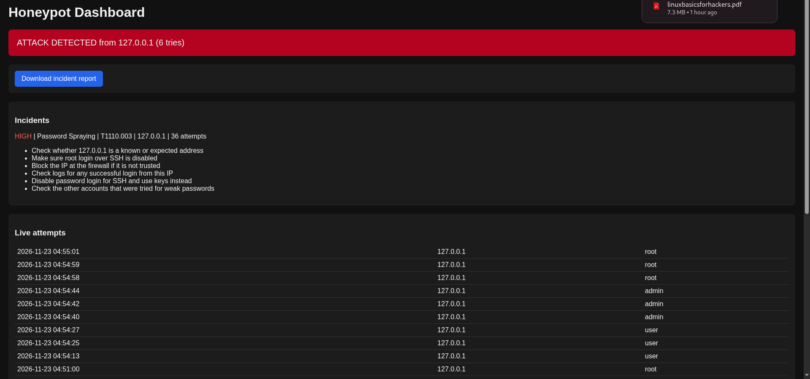

# Honeypot with Auto Incident Reports

A small SSH honeypot that catches login attempts, explains them like a SOC analyst, and shows everything on a live web dashboard.

**Catch, explain, report.**

## What it does
1. **Honeypot** (`honeypot.py`): a fake SSH server on `127.0.0.1:2222`. It records the time, IP, username and password of every login attempt, and always rejects them.
2. **Alert helper** (`alert_helper.py`): reads the log and groups attempts by IP. It adds an attack name, a MITRE ATT&CK tag, a severity level and next steps for an analyst. It leaves passwords out of reports on purpose.
3. **Dashboard** (`dashboard.py`): a Flask web page that refreshes every 2 seconds. It shows live attempts, incident cards, a red alert banner (5+ attempts from one IP in 60 seconds) and a button to download the incident report.

## How to run
You need Python 3, `paramiko` and `flask`.

1. Terminal 1: `python3 honeypot.py`
2. Terminal 2: `python3 dashboard.py`, then open http://127.0.0.1:5000
3. Terminal 3: attack your own honeypot:
   `ssh -p 2222 -o StrictHostKeyChecking=no -o UserKnownHostsFile=/dev/null root@127.0.0.1`
   Type wrong passwords a few times, using usernames like root, admin and user.

## Safety
- Everything listens on `127.0.0.1` only, so it is not reachable from the internet or other computers.
- Only test it on your own machine. Use fake passwords, never real ones.
- The log file holds the passwords typed during tests, so it is not included in this repository.

## Limitations (honest notes)
- Attack types are classified by simple rules. For example, 3 or more usernames from one IP is labelled password spraying, even if the attempts were few.
- It records login attempts only. It does not simulate a shell after login.
- It is a learning project, not a production security tool.

## What I learned
- How SSH brute-force and password spraying look in logs
- Mapping activity to MITRE ATT&CK (T1110)
- Writing a tool that turns raw events into an incident report
- Handling untrusted input safely (usernames are shown as plain text in the dashboard)

## Future improvements
- Better attack classification
- Auto-blocking of repeat attackers
- Per-IP charts and a geographic map
